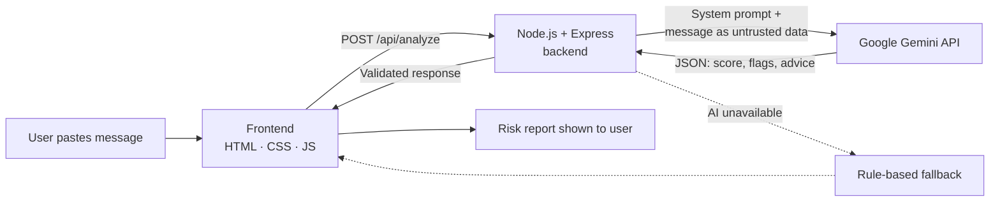

<div align="center">

# 🛡️ SafePay AI

### Your AI shield against financial fraud

**Paste a suspicious message. Get an instant AI risk report. Pay with confidence.**


[🌐 Live Demo](#) · [🎬 Demo Video](#) · [🐞 Report Issue](../../issues)

</div>

> **Replace the `#` links above** with your Render live link and demo video link before submitting.

---

## 📌 The Problem

Digital payments in India have grown fast, and so has **financial fraud**. Fake KYC messages, "your account will be blocked" threats, fake UPI collect requests, prize scams and fake customer-care calls reach millions of people every day. Many victims are first-time digital users who have no quick way to ask *"Is this message safe?"* before they act.

Once the OTP or UPI PIN is shared, the money is usually gone within minutes.

## 💡 Our Solution

**SafePay AI** is a simple, mobile-friendly web app that helps anyone check a suspicious message or link **before** they click, pay or share a code. It uses a large language model (Google Gemini) to analyse the message like a fraud analyst and returns:

- a **risk score from 0 to 100**
- the **specific warning signs** it found
- **plain-language advice** on what to do next
- replies in **English, Hindi or Hinglish**

If the AI is ever unavailable, a built-in rule-based checker takes over, so the app never goes blank.

---

## ✨ Features

| Feature | What it does |
|---|---|
| 🔍 **AI Scam Message Scanner** | Analyses SMS/WhatsApp text and gives a risk score, warning signs and suggested action |
| 🌐 **Multilingual replies** | Choose English, हिंदी or Hinglish for results and answers |
| 🤖 **AI Safety Assistant** | Ask your own questions about UPI, OTP, scams and bank customer-care checks |
| 🔗 **Link Checker** | Reviews a URL for suspicious patterns (no HTTPS, encoded domains, scam keywords, many subdomains) |
| 🧯 **Offline fallback** | A rule-based check runs automatically if the AI is slow or unavailable |
| 📚 **Fraud awareness** | Short guides on red flags: unexpected links, OTP/PIN requests, "pay to receive" tricks, urgency threats |
| 🚨 **Report help** | One-tap guidance to helpline **1930** and the official cybercrime portal |
| 📱 **Responsive design** | Works on phones, tablets and laptops |

---

## 🧠 How the AI Works



1. The user's message is sent to **our own backend**, never directly to the AI provider.
2. The backend wraps it in a **fraud-analyst prompt** designed for Indian scam patterns (UPI, KYC, OTP, lottery, loan, job and customer-care scams).
3. The message is treated as **untrusted data**, so instructions hidden inside a scam message cannot hijack the AI.
4. Gemini returns **structured JSON**. The server validates and clamps it (score 0–100, limited flags) before sending it to the browser.
5. If the call fails or times out, the frontend falls back to the **rule-based detector** and clearly labels the result.

---

## 🔐 Security & Responsible AI

- **API key stays on the server.** It is loaded from `.env` and never exposed to the browser.
- **`.env` is git-ignored**, so secrets are never committed.
- **Input limits:** messages are capped at 2,000 characters and questions at 500.
- **Rate limiting:** 20 requests per minute per IP to protect the API quota.
- **Strict file serving:** only `index.html`, `style.css` and `script.js` are public; server code and secrets are never served.
- **Safe rendering:** all AI output is HTML-escaped before display (protects against XSS).
- **Never asks for secrets:** the assistant is instructed to never request OTP, PIN, CVV or passwords.
- **Honest limits:** every result carries a reminder that AI can make mistakes and users should verify through their bank's official app or number.

---

## 🛠️ Tech Stack

| Layer | Technology |
|---|---|
| Frontend | HTML5, CSS3, Vanilla JavaScript |
| Backend | Node.js, Express |
| AI | Google Gemini API |
| Config | dotenv |
| Hosting | Render |

---

## 📂 Project Structure

```
safepay-ai/
├── index.html        # UI: scanner, link checker, AI assistant, awareness
├── style.css         # Responsive dark-blue design
├── script.js         # Frontend logic, API calls, rule-based fallback
├── server.js         # Express server, Gemini integration, validation
├── package.json      # Dependencies and start script
├── .env.example      # Template for environment variables
├── .gitignore        # Keeps secrets and node_modules out of Git
└── README.md
```

---

## 🚀 Run Locally

**Prerequisites:** Node.js 18 or newer, and a free Gemini API key from [Google AI Studio](https://aistudio.google.com).

```bash
# 1. Clone the repository
git clone https://github.com/YOUR-USERNAME/safepay-ai.git
cd safepay-ai

# 2. Install dependencies
npm install

# 3. Create your environment file
#    (copy .env.example to .env and add your key)

# 4. Start the app
npm start
```

Then open **http://localhost:3000**

**`.env` file:**

```env
GEMINI_API_KEY=your_key_here
GEMINI_MODEL=gemini-3.6-flash
```

> 💡 Gemini model names change often. If a model is busy or unavailable, set `GEMINI_MODEL` to another available Gemini Flash model from your AI Studio list.

---

## 🔌 API Reference

### `POST /api/analyze`
Analyses a message for fraud signals.

```json
// Request
{ "text": "Your account will be blocked. Share OTP now.", "lang": "en" }

// Response
{
  "score": 95,
  "level": "HIGH",
  "flags": ["Urgency tactic", "Request for OTP", "Suspicious link"],
  "advice": "Do not click or share any code. Verify with your bank's official app."
}
```

### `POST /api/chat`
Answers a free-form safety question.

```json
// Request
{ "question": "How do I spot a fake UPI collect request?", "lang": "hinglish" }

// Response
{ "answer": "..." }
```

`lang` accepts `en`, `hi` or `hinglish`.

---

## 🎯 Built for the Arthaton Judging Criteria

| Criterion | How SafePay AI addresses it |
|---|---|
| **Real-world impact** | Targets one of India's most common digital-finance harms: payment fraud affecting everyday users |
| **Relevance to theme** | Directly fits *AI for Finance* → **Scam and fraud detector** |
| **Works end to end** | Frontend → backend → Gemini → validated result → UI, with a tested fallback path |
| **Use of AI** | Gemini analyses messages with a purpose-built prompt and returns structured risk data; also powers a free-form safety assistant |
| **Creativity & originality** | Hinglish support, graceful AI-to-rules fallback, prompt-injection-aware design |
| **Quality of demo** | Clean, responsive UI with instant visual risk reports |

---

## 🗺️ Roadmap

- [ ] Browser extension that flags risky messages in WhatsApp Web
- [ ] Screenshot scanning (paste an image of the message)
- [ ] More regional languages (Bengali, Tamil, Telugu, Marathi)
- [ ] Reputation lookup for links and UPI IDs
- [ ] Voice input for low-literacy users
- [ ] Report-ready summary to help users file a cybercrime complaint

---

## 👥 Team

| Name | Role |
|---|---|
| **Sweta** | Design & development |
| **Pritam** | Design & development |

---

## 🙏 Credits

- **AI:** Google Gemini API
- **Libraries:** [Express](https://expressjs.com), [dotenv](https://github.com/motdotla/dotenv)
- **Fonts:** Space Grotesk, DM Sans (Google Fonts)

---

## ⚠️ Disclaimer

SafePay AI is an **educational prototype** built for a hackathon. It is **not an official bank or fraud-detection service**, and AI can make mistakes. Always verify suspicious requests through your bank's official app or number.

**Never share your OTP, UPI PIN, CVV or passwords with anyone, including this app.**

If you suspect financial fraud in India, call **1930** immediately and report at **[cybercrime.gov.in](https://cybercrime.gov.in)**.

<div align="center">

**Stay Alert. Stay Safe. Build a Fraud-Free India. 🇮🇳**

Made with ❤️ for **Arthaton 2026**

</div>
